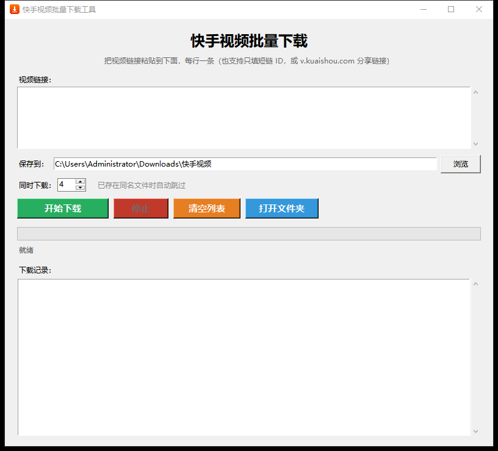

# 快手视频批量下载

一个用来批量下载快手短链接视频的小工具：粘贴一批链接，自动解析视频地址并下载到本地。

界面用 Python 标准库 `tkinter` 写的，**不需要安装任何第三方依赖**。

## 功能

- 一次粘贴多条链接，一行一条；支持完整网址、纯短链 ID、`v.kuaishou.com` 分享短链
- 多线程并发下载（1–8 可调），界面不卡
- 进度条 + 彩色日志：成功 / 已存在 / 失败分色显示
- 下载完成后自动生成 `下载清单_时间戳.txt`，记录每条链接的结果和文件大小
- 已下载的同名文件自动跳过，可断点续跑
- 先写 `.part` 再改名，中断不会留下半截视频

## 使用

### 方式一：直接运行 exe

从 [Releases](../../releases) 下载 `快手视频下载.exe`，双击即可。

> 首次启动会解压到临时目录，大约慢 2–3 秒；因为没有代码签名，Windows SmartScreen 可能提示"未知发布者"，点「更多信息 → 仍要运行」。

### 方式二：用 Python 运行源码

需要 Python 3.9+（自带 tkinter 即可，无需 pip install）：

    git clone https://github.com/YenPowen/kuaishou-video-downloader.git
    cd REPO
    python kuaishou_download.py

Windows 上也可以直接双击 `.pyw` 版本，不会弹出黑色控制台。

### 方式三：命令行版

    python kuaishou_download_cli.py -f urls.txt -o ./downloads -j 6

    # 或者直接贴链接
    python kuaishou_download_cli.py https://www.kuaishou.com/short-video/3xnpwak69gk2p9c

## 文件名规则

   001_3xnpwak69gk2p9c.mp4
   ^^^  ^^^^^^^^^^^^^^^^
    |        └── 快手短链 ID
    └── 该链接在输入列表里的行号（从 1 开始）

序号只反映**你粘贴的顺序**，与发布时间、点赞、作者无关。下载失败的那条不会产生文件，所以编号会出现跳号。

> 注意：换一批顺序再跑，同一视频的序号会变，因此「跳过已存在」是按完整文件名判断的，换顺序可能重复下载。

## 实现思路

浏览器打开快手视频页看到的是前端渲染的空壳，官方 GraphQL 接口又会返回滑动验证码。这个工具走的是移动端分享页：

    https://m.kuaishou.com/fw/photo/{短链ID}
    
配合 iPhone UA 请求，服务端会返回渲染好的 HTML，里面的 `photo` JSON 就带有 `mainMvUrls`（mp4 直链）、作者、封面等信息，抠出来直接下 CDN 即可。

## 常见问题

**有些链接提示"页面无视频数据"？**
这类链接服务端返回的是不含视频数据的空页面，通常是作品已删除、设为私密、或仅登录可见。换登录态 Cookie 才有可能拿到。

**会不会被限流？**
并发建议不超过 6。请求过密时快手会返回空页面，降低并发或稍等再跑即可。

**下载的视频没有文案/标题？**
未登录状态下快手不返回文案（`caption` 是 `...`），所以文件名只能用 ID。

## 免责声明

仅供个人学习与备份自己有权保存的内容使用。请遵守快手用户协议与相关法律法规，不要用于批量搬运、二次分发等侵权用途。作者不对使用者的行为负责。

## License

[MIT](LICENSE)
